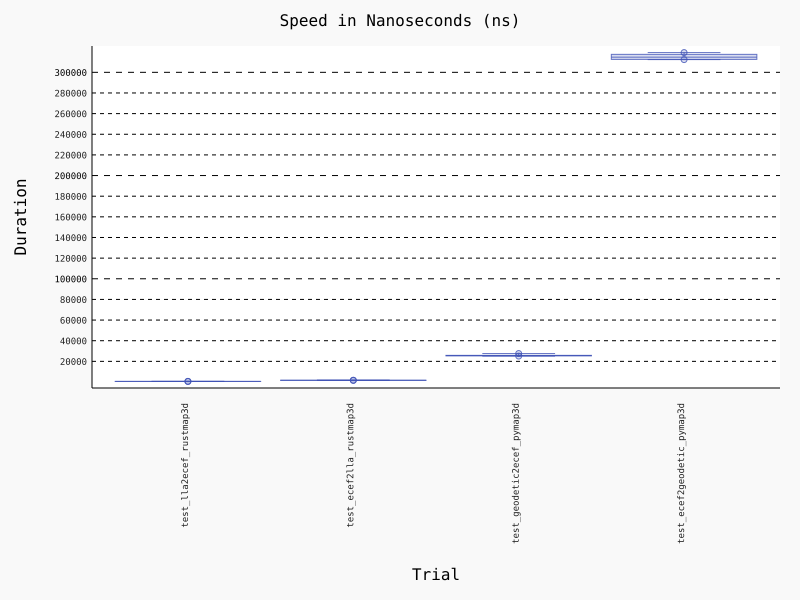
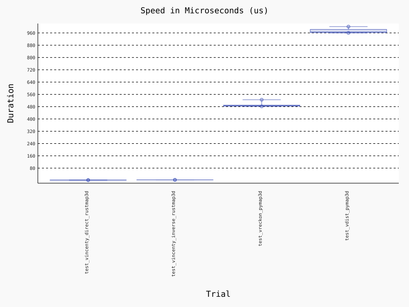
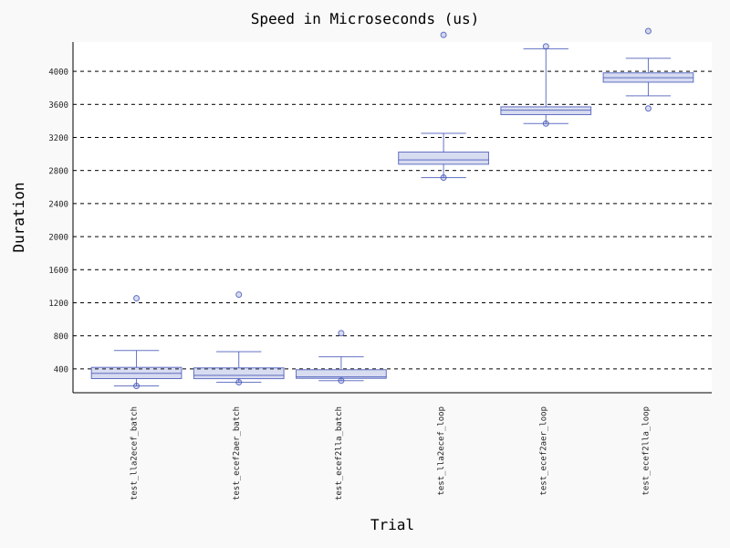
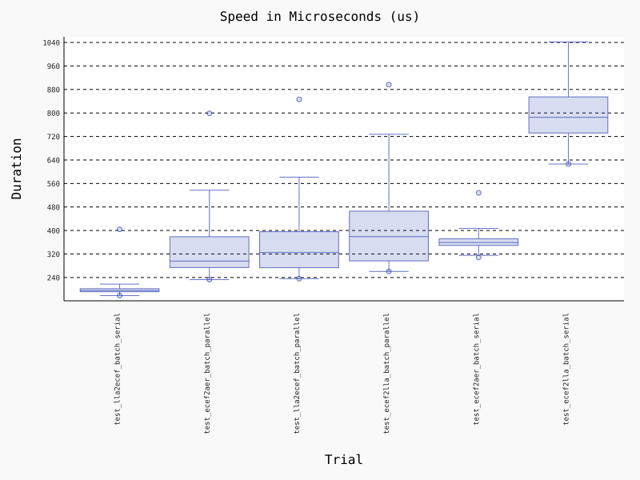
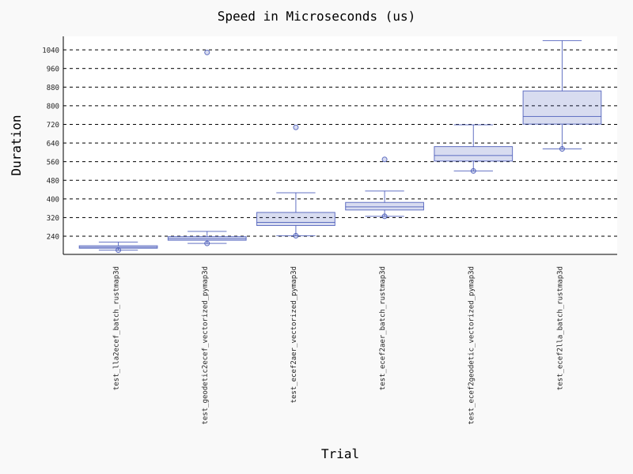

# rustmap3d

[](https://github.com/lskyweiler/rustmap3d#license)

[](https://pypi.org/project/rustmap3d/)
[](https://crates.io/crates/map3d)
[](https://github.com/astral-sh/ruff)

<!-- markdownlint-disable-next-line -->
<p align="center"></p>

<!-- markdownlint-disable-next-line -->
**Simple, fast, and ergonomic geodetic coordinate conversions**

---

## Installation

```bash
# add to an existing project
uv add rustmap3d
# pip install it directly
uv pip install rustmap3d

# pip install without uv
pip install rustmap3d
```

---

## Examples

Low-level transforms api similar to [pymap3d](https://github.com/geospace-code/pymap3d) and [matlab](https://www.mathworks.com/matlabcentral/fileexchange/15285-geodetic-toolbox)

```python
import rustmap3d


# wgs84 geodetic conversions
lla = rustmap3d.ecef2lla(x, y, z)
ecef = rustmap3d.lla2ecef(lat, lon, alt)
...

# local conversions
ecef_uvw = rustmap3d.enu2ecef_uvw(e, n, u, lat_ref, lon_ref)
ecef = rustmap3d.enu2ecef(e, n, u, lat_ref, lon_ref)
ecef_uvw = rustmap3d.ned2ecef_uvw(n, e, d, lat_ref, lon_ref)
ecef = rustmap3d.ned2ecef(n, e, d, lat_ref, lon_ref)
# enu, ned, aer
...

# local rotations
enu_quat = rustmap3d.enu2ecef_quat(lat, lon)
enu_dcm = rustmap3d.enu2ecef_dcm(lat, lon)
# enu, ned

# Conversions
dd = rustmap3d.dms2dd("25:22:44.738N")  # > 25.37909389
dms = rustmap3d.dd2dms(25.37909389, is_lat=true)  # > "25:22:44.738N"
lat, lon = rustmap3d.ll2dms(
    25.37909389, -138.7895679
)  # > "25:22:44.738N", "138:47:22.444W"
...

# distance functions
lat, lon = rustmap3d.vincenty_direct(lat_deg, lon_deg, range_m, bearing_deg)
range_m, bearing_ab, bearing_ba = rustmap3d.vincenty_inverse(lat_a, lon_a, lat_b, lon_b)
```

Batched conversion functions

```python
import numpy as np
import rustmap3d


# Optional: configures the number of threads available for parallel batch processing
#   defaults to all threads
rustmap3d.configure_threads(8)


# inputs are anything numpy converts to an (N, 3) float64 array
llas = np.array(
    [
        [0.0, 0.0, 100.0],
        [38.9, -77.0, 120.0],
        [-33.9, 151.2, 0.0],
    ]
)

# wgs84 geodetic conversions
ecefs = rustmap3d.lla2ecef_batch(llas)  # > (3, 3) array of x, y, z
llas = rustmap3d.ecef2lla_batch(ecefs)
llas = rustmap3d.ecef2lla_batch([[6378137.0, 0.0, 0.0]])  # lists of rows work too
...

# local conversions share one reference for the whole batch
lat_ref, lon_ref, alt_ref = 38.9, -77.0, 120.0
enus = rustmap3d.ecef2enu_batch(ecefs, lat_ref, lon_ref, alt_ref_m=alt_ref)
ecefs = rustmap3d.enu2ecef_batch(enus, lat_ref, lon_ref, alt_ref_m=alt_ref)
neds = rustmap3d.lla2ned_batch(llas, lat_ref, lon_ref, alt_ref_m=alt_ref)
llas = rustmap3d.ned2lla_batch(neds, lat_ref, lon_ref, alt_ref_m=alt_ref)
ecef_uvws = rustmap3d.enu2ecef_uvw_batch(enus, lat_ref, lon_ref)
# enu, ned, aer, and their _uvw forms
...

# aer
aers = rustmap3d.ecef2aer_batch(ecefs, lat_ref, lon_ref, alt_ref_m=alt_ref)
az, el, rng = aers.T  # columns are azimuth, elevation, range
ecefs = rustmap3d.aer2ecef_batch(aers, lat_ref, lon_ref, alt_ref_m=alt_ref)
enus = rustmap3d.aer2enu_batch(aers)
aers = rustmap3d.enu2aer_batch(enus)
# ned2aer, aer2ned, ecef_uvw2aer, aer2ecef_uvw
...

# anything that isn't shaped (N, 3) raises ValueError
try:
    rustmap3d.lla2ecef_batch([0.0, 0.0, 100.0])
except ValueError:
    ...
```

High-level GeoObject API

```python
import math
import pydantic
import rustmap3d

# Construct a GeoPosition from either global or local coordinates
reference = rustmap3d.GeoPosition.from_lla((0.0, 0.0, 0.0))
rustmap3d.GeoPosition.from_enu(rustmap3d.DVec3(100.0, 0.0, 0.0), reference)
rustmap3d.GeoPosition.from_ned(rustmap3d.DVec3(100.0, 0.0, 0.0), reference)
# all reference locations accept LLA tuples or GeoPositions for reference locations
pos = rustmap3d.GeoPosition.from_aer(rustmap3d.DVec3(90.0, 0.0, 100.0), (0.0, 0.0, 0.0))

# Conversions
reference.aer_to(pos)  # > DVec3
reference.ned_to(pos)  # > DVec3
reference.enu_to(pos)  # > DVec3

# Operations
vec = pos - reference  # > GeoVector
new_pos = reference + vec  # > GeoPosition

vel = rustmap3d.GeoVelocity.from_dir_speed(rustmap3d.DVec3(1.0, 0.0, 0.0), 100.0)
dt = 1.0
pos = reference + vel * dt  # > GeoPosition

rotation = rustmap3d.GeoOrientation.from_ecef_euler(rustmap3d.DVec3(0.0, math.pi, 0.0))
vec = rustmap3d.GeoVector.from_ecef(rustmap3d.DVec3(100.0, 0, 0.0), reference)
vec = rotation * vec  # > GeoVector

# Orientations
rot = rustmap3d.GeoOrientation.from_axis_angle(rustmap3d.DVec3(0.0, 0.0, 1), math.pi)
rot.x_axis()  # > DVec3
rot.y_axis()  # > DVec3
rot.z_axis()  # > DVec3


# There is also native pydantic integration for geo objects
class MyModel(pydantic.BaseModel):
    pos: rustmap3d.GeoPosition


model = MyModel(pos=rustmap3d.GeoPosition.from_lla((0.0, 0.0, 0.0)))
dumped = model.model_dump(mode="json")
print(dumped)  # > { "pos": { "ecef": [6378137.0, 0., 0.] } }

validated = MyModel.model_validate(dumped)
```

## Comparison with similar packages

- 🚀🚀 Blazingly fast - written in rust (see [benchmarks](#benchmarks))
- Has optimizations for single point transformations as well as vectorized batch transforms
- Zero dependencies
- Dead simple api modeled after [pymap3d](https://github.com/geospace-code/pymap3d) and [matlab](https://www.mathworks.com/matlabcentral/fileexchange/15285-geodetic-toolbox)
- Exposes rotations (both quaternions and 3x3 matrices)
- High-level `GeoObject` API

## Benchmarks

Compared to [pymap3d](https://github.com/geospace-code/pymap3d)

```bash
# Run benchmarks
uv run task bench
# > outputs histograms to docs/benches/
```

### Single-call performance

Benchmarks for transforming single points

- _~50x_ faster for lla2ecef
- _~400x_ faster for ecef2lla

<!-- markdownlint-disable-next-line -->
<p align="center"></p>

### Vincenty performance

Benchmarks for direct and inverse vincenty functions on single points

<!-- markdownlint-disable-next-line -->
<p align="center"></p>

### Vectorized Performance vs Single Points

Benchmarks for transforming a batch of points vs looping over single points

<!-- markdownlint-disable-next-line -->
<p align="center"></p>

### Vectorized Performance for Parallel vs Serial Execution

<!-- markdownlint-disable-next-line -->
<p align="center"></p>

### Vectorized Performance vs `pymap3d`

Benchmarks for transforming a batch of points vs `pymap3d`

<!-- markdownlint-disable-next-line -->
<p align="center"></p>

## Build From Source

Uses standard [maturin](https://github.com/PyO3/maturin) build process

```bash
uv run maturin build -r   # build a whl
uv run maturin dev -r     # build a dev package similar to -e
```
